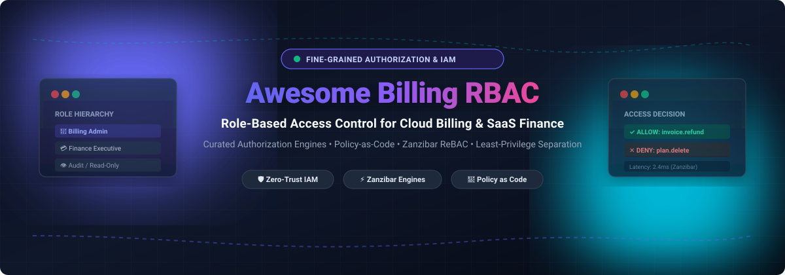

# Awesome Billing Role-Based Access Control (RBAC) 🔐⚡

<p align="center">
  
</p>

<p align="center">
  <a href="https://github.com/ishandutta2007/Awesome-Awesome-Awesome"></a>
  <a href="https://discord.gg/jc4xtF58Ve"></a>
  <a href="https://github.com/ishandutta2007/Awesome-Billing-Role-Based-Access-Control-RBAC/stargazers"></a>
  <a href="https://github.com/ishandutta2007/Awesome-Billing-Role-Based-Access-Control-RBAC/network/members"></a>
  <a href="https://github.com/ishandutta2007/Awesome-Billing-Role-Based-Access-Control-RBAC/blob/main/LICENSE"></a>
  <a href="https://github.com/ishandutta2007"></a>
</p>

---

## 🌟 Overview & Highlights

A curated index of top **SaaS solutions**, **Cloud IAM providers**, and **Open-Source Authorization Engines** engineered for **Billing Role-Based Access Control (RBAC)**, **Attribute-Based Access Control (ABAC)**, **Relationship-Based Access Control (ReBAC / Google Zanzibar)**, and **Least-Privilege Policy Enforcement**.

Whether you are designing multi-tenant SaaS subscription billing, safeguarding customer invoice refunds, enforcing separation of duties for finance audits (SOX / PCI-DSS compliance), or managing role delegation across cloud accounts, this guide connects you with proven industry solutions and self-hosted frameworks.

---

## 📑 Table of Contents
- [📊 Sector Overview & Market Dynamics](#-sector-overview--market-dynamics)
- [☁️ SaaS / Hosted Platforms](#️-saas--hosted-platforms)
- [🔓 Open-Source GitHub Projects](#-open-source-github-projects)
- [🛠️ Architecture & Implementation Guide](#️-architecture--implementation-guide)
- [🤝 How to Contribute](#-how-to-contribute)
- [💖 Support & Sponsorship](#-support--sponsorship)
- [📈 Star History](#star-history)
- [⚠️ Disclaimer](#️-disclaimer)

---

## 📊 Sector Overview & Market Dynamics

The global **Identity and Access Management (IAM)** and **Role-Based Access Control (RBAC)** market is estimated at approximately **$25.5B–$26.8B in 2025** and projected to reach **$29.3B–$29.7B in 2026** (with core RBAC representing ~$14.3B), expanding at ~11–14% CAGR through 2034. 

The sector exhibits a **moderately fragmented** market structure: while hyperscalers (Microsoft, Amazon AWS, Google Cloud) and established identity pure-plays (Okta, CyberArk) hold roughly 30–40% aggregate market share, specialized billing orchestration engines, cloud-native authorization microservices, and niche policy-as-code platforms prevent winner-take-all monopolization, leaving substantial runway for open-source self-hosted solutions.

---

## ☁️ SaaS / Hosted Platforms

Below are leading hosted IAM, billing entitlement, and enterprise role governance platforms, ranked by company valuation / market capitalization (descending):

| Platform 🏢 | Company Valuation / Revenue 💰 | Starting Tier Pricing 💳 | Free Tier / Free Trial Limits 🎁 | Role & Billing Authorization Capabilities 🛡️ |
| :--- | :--- | :--- | :--- | :--- |
| **[Microsoft Entra ID Roles](https://www.microsoft.com/en-us/security/business/identity-access/microsoft-entra-id)** | ~$3.1T Market Cap (Microsoft) | Paid plans start at **$7.00/user/month** (P1) or **$10.00/user/month** (P2) | **Free plan** included with cloud subscriptions (unlimited directory users/groups, basic directory features, external identities up to **50,000 monthly active users (MAUs) free**); 30-day trial for P1/P2 | Built-in and custom cloud IAM role definitions; scopes permissions across tenants, administrative units, and subscription billing resources. |
| **[AWS IAM Roles](https://aws.amazon.com/iam/)** | ~$2.2T Market Cap (Amazon) | **$0.00** (Core IAM feature is free; billed strictly for underlying AWS cloud resources consumed) | **Free forever** (100% free with no monthly expiration or feature cap for standard IAM roles, policies, and users; AWS Free Tier provides 12 months free / Always Free quotas on connected cloud resources) | Identity-based policies, resource policies, permission boundaries, and Service Control Policies (SCPs) protecting cost management and billing APIs. |
| **[Google Cloud IAM](https://cloud.google.com/iam)** | ~$2.1T Market Cap (Alphabet) | **$0.00** (Standard Cloud IAM is entirely free; pay only for underlying GCP services consumed) | **Free forever** (Indefinite free usage with no fees for IAM roles, permissions, or API calls; Cloud Identity Free includes up to **50 user licenses**; GCP offers a 90-day $300 trial credit for new accounts) | Predefined and custom roles with fine-grained billing permissions (`billing.accounts.*`, `billing.budgets.*`), resource hierarchies, and inheritance. |
| **[Okta RBAC](https://www.okta.com/)** | ~$33.4B Market Cap | Paid Workforce plans start at **$6.00/user/month** (Starter tier, $1,500/year annual minimum contract) | **30-day free trial** limited to up to **10 users** per tenant with access to core SSO, MFA, Universal Directory, and up to 5 active workflows | Standard administrative roles and custom admin roles with granular API privileges, enforcing least privilege for finance and billing admins. |
| **[CyberArk RBAC](https://www.cyberark.com/)** | ~$25.0B Acquisition Valuation / ~$20B Market Cap | Standard AWS Marketplace packages start at **$149/user/month** ($44,712/year for 25 standard users; volume contracts scale to ~$50–$92/user/month) | Guided **30-day Proof of Concept (PoC)** / evaluation upon enterprise sales request with partner scoping (no public self-service free tier) | Privileged access management with built-in roles mapped to license tiers, enforcing separation between high-risk financial and infrastructure operations. |
| **[Auth0 Roles](https://auth0.com/)** | ~$6.5B Acquisition Valuation (Subsidiary of Okta) | Paid B2C plans start at **$35/month** (up to 500 MAUs); B2B SaaS plans start at **$150/month** (up to 500 MAUs) | **Free forever plan** with limit of up to **25,000 Monthly Active Users (MAUs)**, unlimited social logins, 1 custom domain, and 1 enterprise connection; paid tiers offer 22-day self-serve trial | Authorization Core providing RBAC with roles spanning permissions from multiple APIs, designed for SaaS customer portals and billing seats. |
| **[Chargebee Role-Based Access Control](https://www.chargebee.com/)** | ~$3.5B Valuation | Performance plan starts at **$599/month** (billed annually at $7,188/year for up to $100k/mo MRR + 0.75% overage) | **Free Starter tier** covers up to **$250,000 in cumulative lifetime billing** (0.75% overage fee thereafter); offers **14-day** fully-featured free trial | Subscription billing platform with built-in roles (Finance Executive, Analyst, Tech Support) and custom CSV-based privilege matrices. |
| **[Ping Identity RBAC](https://www.pingidentity.com/)** | ~$2.8B Acquisition Valuation (Thoma Bravo) | Workforce Essential plan starts at **$3/user/month** (requires mandatory minimum 5,000 users = $180,000/year contract floor); CIAM starts at $35,000/year | Guided **30-day sandbox / enterprise evaluation** trial upon sales request; no perpetual free tier | Enterprise identity platform with internal authorization roles grantable via REST or admin UI, supporting conditional role grants for finance workflows. |
| **[JumpCloud RBAC](https://jumpcloud.com/)** | ~$2.6B Valuation | Standalone SSO & MFA starts at **$11/user/month** ($13 monthly); Device Identity starts at **$13/user/month** | **30-day free trial** with full platform access (legacy accounts created prior to Feb 1, 2024 retain 10 users / 10 devices free forever) | Cloud directory platform with admin/sudo permission management, user groups, and temporary elevated privileges for time-bound billing access. |
| **[OneLogin Roles](https://www.onelogin.com/)** | ~$500M+ Acquisition Valuation (One Identity) | Essentials tier starts at **$3/user/month**; Advanced/Business starts at **$4–$6/user/month** | **30-day free trial** sandbox for administrative testing and policy configuration (up to 25 test users) | Identity platform structuring roles as collections of apps to simplify billing system access provisioning and automated deprovisioning. |

---

## 🔓 Open-Source GitHub Projects

Self-hosted authorization engines, policy-as-code libraries, and identity management servers with native RBAC, sorted by GitHub stargazers count (descending):

1. **[Keycloak](https://github.com/keycloak/keycloak)** [](https://github.com/keycloak/keycloak/stargazers) 🛡️  
   *Open-source Identity and Access Management for modern applications and services.*  
   Provides comprehensive RBAC, Fine-Grained Admin Permissions (FGAP V2), and authorization services. Supports realms, groups, client roles, and role mappings for isolating billing administrative operations from general application tiers.

2. **[Authelia](https://github.com/authelia/authelia)** [](https://github.com/authelia/authelia/stargazers) 🔑  
   *The single sign-on multi-factor portal for web apps.*  
   Lightweight authentication and authorization server with granular access control rules based on user identity, group membership, network location, and requested resource paths—ideal for securing internal billing dashboards.

3. **[Casbin](https://github.com/casbin/casbin)** [](https://github.com/casbin/casbin/stargazers) ⚡  
   *An authorization library that supports access control models like ACL, RBAC, and ABAC in Golang.*  
   Supports multi-tenancy with domains, hierarchical roles with resource inheritance, and custom policy definitions across Go, Java, Node.js, Python, PHP, .NET, and Rust. Features extensive middleware integrations for web frameworks.

4. **[Ory Hydra](https://github.com/ory/hydra)** [](https://github.com/ory/hydra/stargazers) 🌐  
   *OpenID Connect and OAuth2 Server with hardened security.*  
   Hardened OAuth 2.0 and OpenID Connect engine with fine-grained access token scoping, enabling secure delegation of financial and billing API actions across third-party apps and internal microservices.

5. **[ZITADEL](https://github.com/zitadel/zitadel)** [](https://github.com/zitadel/zitadel/stargazers) 🏰  
   *Open-source identity infrastructure built with event sourcing.*  
   Provides B2B multi-tenancy out of the box with organizations, projects, granted projects, and role mappings. Perfect for multi-tenant SaaS platforms that need tenant-specific billing roles and immutable audit logs.

6. **[SuperTokens](https://github.com/supertokens/supertokens-core)** [](https://github.com/supertokens/supertokens-core/stargazers) 🚀  
   *Open-source alternative to Auth0, AWS Cognito, and Firebase Auth.*  
   Modular authentication platform supporting native User Roles and Permissions (RBAC). Enables associating permissions (e.g., `read:invoices`, `refund:payment`) with roles stored in user session claims for instant verification.

7. **[Casdoor](https://github.com/casdoor/casdoor)** [](https://github.com/casdoor/casdoor/stargazers) 🚪  
   *An open-source UI-first Identity and Access Management (IAM) / Single-Sign-On (SSO) platform.*  
   Built on Casbin, Casdoor delivers an out-of-the-box web UI for managing organizations, users, applications, permissions, and roles with OAuth 2.0, OIDC, SAML, and CAS support.

8. **[Ory Kratos](https://github.com/ory/kratos)** [](https://github.com/ory/kratos/stargazers) 👤  
   *Cloud-native identity and user management system.*  
   Manages user profiles, credentials, identity schemas, and session lifecycle with first-class headless APIs, easily integrated with authorization layers for role and billing tier assignments.

9. **[OPA (Open Policy Agent)](https://github.com/open-policy-agent/opa)** [](https://github.com/open-policy-agent/opa/stargazers) 📜  
   *Open-source, general-purpose policy engine.*  
   Uses the declarative Rego language to decouple authorization decisions from billing services. Evaluates context (WHO, WHAT, WHEN, WHERE, subscription tier, billing status) and emits structured audit logs for compliance.

10. **[Dex](https://github.com/dexidp/dex)** [](https://github.com/dexidp/dex/stargazers) 🔌  
    *A federated OpenID Connect identity provider.*  
    Acts as an identity broker connecting enterprise LDAP, SAML 2.0, GitHub, and Google logins to Kubernetes clusters and billing backends with group-to-role mappings.

11. **[OpenFGA](https://github.com/openfga/openfga)** [](https://github.com/openfga/openfga/stargazers) 🎯  
    *A high-performance and flexible authorization/permission engine built for developers and inspired by Google Zanzibar.*  
    CNCF sandbox project allowing fine-grained authorization modeling (RBAC, ABAC, ReBAC) with sub-millisecond evaluation, ideal for complex billing hierarchies (e.g., organization ➔ billing account ➔ subscription ➔ invoice).

12. **[Permify](https://github.com/Permify/permify)** [](https://github.com/Permify/permify/stargazers) 🧱  
    *Open-source authorization-as-a-service inspired by Google Zanzibar.*  
    Provides relationship-based access control (ReBAC) with sub-10ms decision checks, distributed multi-tenant isolation, and a domain-specific authorization modeling language tailored for SaaS products.

13. **[Ory Keto](https://github.com/ory/keto)** [](https://github.com/ory/keto/stargazers) ⛩️  
    *Zanzibar-like access control server written in Go.*  
    Ultra-fast implementation of Google Zanzibar's access control specification with gRPC and REST APIs for checking permissions and managing relation tuples in billing microservices.

14. **[Cerbos](https://github.com/cerbos/cerbos)** [](https://github.com/cerbos/cerbos/stargazers) ⚙️  
    *Stateless policy-as-code authorization service.*  
    Enables authoring context-aware access control policies in human-readable YAML/JSON with SDKs in Go, Python, Node.js, Java, and .NET. Perfect for evaluating dynamic conditions (e.g., `request.user.role == "finance_manager" && resource.invoice.amount < 10000`).

15. **[Ory Oathkeeper](https://github.com/ory/oathkeeper)** [](https://github.com/ory/oathkeeper/stargazers) 🛡️  
    *Identity and Access Proxy (IAP) and Zero-Trust ingress gateway.*  
    Authenticates, authorizes, and mutates incoming HTTP requests based on granular rules before they reach upstream billing APIs and internal administration tools.

16. **[Cedar](https://github.com/cedar-policy/cedar)** [](https://github.com/cedar-policy/cedar/stargazers) 🌲  
    *Fast, ergonomic, and provably secure policy language and authorization engine.*  
    Developed by AWS and open-sourced, Cedar provides expressive syntax, formal verification with automated reasoning, and microsecond evaluation for custom SaaS billing role policies.

17. **[Topaz](https://github.com/aserto-dev/topaz)** [](https://github.com/aserto-dev/topaz/stargazers) 💎  
    *Open-source authorization service combining OPA policies with a Zanzibar relation graph.*  
    Combines the best of Open Policy Agent (Rego rules) with Google Zanzibar (entity relation graphs) into a single edge-deployable daemon for sub-millisecond billing access checks.

18. **[go-iam](https://github.com/melvinodsa/go-iam)** [](https://github.com/melvinodsa/go-iam/stargazers) 📦  
    *Lightweight multi-tenant IAM server in Go.*  
    Features RBAC, custom roles, resource grouping, OAuth provider integration (Google, Microsoft, GitHub), and a React admin interface.

19. **[wardn](https://github.com/MogRex-Limited/wardn)** [](https://github.com/MogRex-Limited/wardn/stargazers) 🔒  
    *Opinionated authorization library for Go.*  
    Configured via YAML policy files with roles, permissions, and scope hierarchies; features built-in privilege escalation prevention during role creation.

---

## 🛠️ Architecture & Implementation Guide

When building billing RBAC for SaaS architectures, combining specialized tools yields the most resilient, auditable design:

```
                  ┌────────────────────────────────────────┐
                  │          Inbound Billing API           │
                  └───────────────────┬────────────────────┘
                                      │
                         [Identity Verification]
                                      ▼
                        Keycloak / ZITADEL / Authelia
                                      │
                         [Permission & Role Check]
                                      ▼
                   OpenFGA / Cerbos / Casbin / OPA Engine
                      ├── WHO: Finance Executive
                      ├── WHAT: invoice.issueRefund
                      └── CONDITIONS: refund_amount <= $5,000
                                      │
                           ALLOW      ▼      DENY
                 ┌────────────────────┴────────────────────┐
                 │                                         │
                 ▼                                         ▼
   Stripe / Chargebee Webhook Execution             HTTP 403 Forbidden
     + Audit Event Emitted                            + Security Alert Logged
```

1. **Identity & Authentication**: Leverage **Keycloak**, **ZITADEL**, or **Auth0** for tenant provisioning, SSO federation, and user identity lifecycle.
2. **Authorization Engine**: Embed **Casbin** or **Cedar** in-process, or deploy **OpenFGA**, **Cerbos**, or **OPA** as a sidecar for sub-10ms decision resolution.
3. **Audit & Compliance**: Ensure every role assignment and billing action (credit issuance, pricing plan mutation, refund approval) produces an immutable, auditable log for SOX / SOC 2 / PCI-DSS compliance.

---

## 🤝 How to Contribute

We welcome community contributions from security engineers, identity architects, and developers!

1. 🍴 **Fork the repository** on GitHub.
2. 🌿 **Create a new branch** (`git checkout -b feat/add-authorization-tool`).
3. 📝 **Add your project** in the appropriate section maintaining the descending sort order and badge format.
4. 🧪 **Ensure descriptions** are factual, concise, and include official links.
5. 🚀 **Submit a Pull Request** with a brief summary of the project's billing RBAC features.

---

## 💖 Support & Sponsorship

If you find this curated ecosystem helpful for your architectural research or SaaS production stack, consider supporting its continuous maintenance:

- ⭐ **Star this repository** to help others discover it.
- 🍴 **Fork and share** with fellow engineers and platform teams.
- ☕ **Buy a coffee & sponsor**: Support active open-source curation on the [GitHub Sponsor Dashboard](https://github.com/sponsors/ishandutta2007).

Your sponsorship directly funds research, benchmark verifications, and regular ecosystem updates!

---

##  Star History
[](https://www.star-history.com/#ishandutta2007/Awesome-Billing-Role-Based-Access-Control-RBAC&type=date&legend=top-left)

---

## ⚠️ Disclaimer

- This repository is a **community-curated index** for educational and architectural evaluation purposes; it does not constitute a formal commercial endorsement.
- Billing access implementations must enforce strict separation of duties (e.g., segregating billing subscription modification from payment refund issuance) to satisfy regulatory and financial governance requirements.
- Self-hosted policy engines require periodic privilege audits and access reviews to protect against permission creep.

---

<p align="center">
  <b>Designed for SaaS finance engineers, security platform architects, and developers building robust billing access control.</b><br/>
  Made with ❤️ by the open-source authorization community.
</p>
